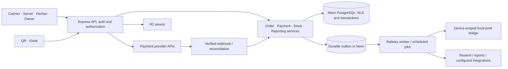

# Architecture and domain contracts

This is the target architecture. Names below are proposed new modules/tables, not claims that implementation already exists.

## Application structure

Use a modular monolith: one Express API, one React/Vite application with role-specific routes, and shared TypeScript domain/validation packages where useful. QR/kiosk can have a separate frontend entry point while sharing the same catalog, checkout contracts, and services. Do not build microservices to reproduce existing screens.

Keep feature code organized around `auth`, `tenancy`, `catalog`, `orders`, `payments`, `kitchen`, `inventory`, `purchasing`, `cash`, `reporting`, `team`, `billing`, and `integrations`. Transport handlers parse/authorize/delegate; business rules live in testable services. Frontend components do not independently define tax, discounts, payment totals, or stock rules.

## Tenant and identity model

An organization owns restaurants/locations. A restaurant is the primary operational isolation boundary. Memberships assign users/employees to one or more restaurants with capabilities. An organization aggregate must enumerate authorized locations; it is not permission to bypass isolation globally.

Use separate account authentication, short-lived employee/PIN sessions, and device credentials. Hash PINs/passwords with a modern password hashing function and rate-limit attempts. Server checks enforce capability, restaurant, account/device status, and session expiry. Browser account sessions should use secure HttpOnly cookies with appropriate CSRF protection; devices use scoped credentials appropriate to their environment. Never store a reusable manager PIN approval in local storage.

As built (access, migration 023; [ACCESS.md](ACCESS.md)): a browser becomes a device either as a shared **terminal**, paired with a single-use 10-minute code (8 Crockford base32 characters, stored only as an HMAC) that an owner or manager creates in Dispositivos, or as a **personal** device through the owner's or an invited member's Google entry. The signed `gm_device` cookie expires 30 days after the last sign-in and stops working at once when the device is unpaired. Staff sign in on a paired device by choosing their name and entering a PIN; PIN failures are throttled per employee and device with staged locks and a hard lock at 100. Every session is created by `createSession()`: `expires_at` slides to at most 8 hours after the last activity and never past `absolute_expires_at` (16 hours after a PIN sign-in). Sessions **end** (logout, switch, PIN reset, role change) or are **revoked** (employee deactivated, device unpaired), and authentication names the reason so the client shows the lock or the pairing screen. On terminals, refunds, paid-outs, self-approved voids and staff/device commands require a PIN entered within the step-up window (`requireRecentAuth`, `ACCESS_STEP_UP_SECONDS`, default 120 s); a manager approves a cashier's void by choosing their name and entering their own PIN. Idle PIN sessions show a lock screen that keeps the workspace mounted.

Every tenant-owned table needs a non-null tenant ID, RLS `USING` and `WITH CHECK`, and tenant-aware references. Use composite foreign keys where necessary to prevent a row belonging to tenant A from referencing tenant B's menu item, order, device, or ingredient. Grant only necessary permissions. Audit tables disallow arbitrary update/delete for normal roles.

Tenant access must run inside an explicit transaction with `set_config('app.tenant_id', tenantId, true)` on the same connection. The tenant ID comes from validated membership or a scoped public/device credential, not an untrusted header. Missing context throws. Privileged provisioning/migration functions require explicit clients and cannot be the default fallback for ordinary queries.

Keep transactions short. Authenticate and resolve necessary context, then open the operation's transaction; do not hold a database connection while waiting for a terminal, network upload, print acknowledgement, or user action. Test pooling behavior, rollback, aborted requests, and subsequent connection reuse.

## Canonical entities

| Domain | Proposed entities / constraints |
| --- | --- |
| Identity | organizations, restaurants, accounts, memberships, employees, devices, sessions, role capabilities |
| Catalog | menu categories/items, modifier groups/options, item-group links, combos/slots, promotions, price/tax versions |
| Service | tables, orders, order lines, line modifiers, order rounds, fulfillment events, station dispatches/acknowledgements |
| Payments | payment attempts, tenders, tender allocations, payment groups, refund attempts/refunds, provider events |
| Inventory | ingredients/stock items, units/conversions, recipe versions/lines/substitutes, prep runs/inputs/outputs, stock movements, reservations, counts, lots/expiry |
| Purchasing/cash | suppliers, purchase orders/receipts, expenses, recurring expense schedules, cash sessions, cash movements, count records |
| Owner insight | report projections/views, targets, scenario assumptions, alerts and resolutions, report runs |
| Supporting | jobs/outbox, print jobs, audit events, source mappings, import batches/rows/reconciliation, integration credentials |

Choose IDs consistently; UUIDs are a good new-domain default, with source IDs preserved separately. Orders/lines/tenders need immutable identities independent of receipt numbers. Daily receipt/order numbering is generated atomically per restaurant/business date, never from an unlocked `MAX + 1`; the daily call number ("#42") keeps resetting each business day and keeps its kitchen role. The fiscal folio is a separate scheme (fiscal 027, [FISCAL.md](FISCAL.md)): tenant-wide per optional series, consecutive and gapless by design because RMF rule 2.7.1.21 requires a consecutive folio on the comprobante simplificado. It comes from a row-locked counter (`fiscal_folio_counters`, not a sequence, so a rollback restores it), a deferred trigger refuses to commit a counter value without its ticket, and `UNIQUE(tenant_id, series, number)` blocks duplicates.

## Separate state machines

Preparation/fulfillment: `draft → active → ready → completed`, plus explicitly permitted cancellation. Keep per-round/line acknowledgement fields for station progress rather than manufacturing preparation states from payment methods. A source/channel field records POS/kiosk/QR/delivery/offline origin.

Order balance: `unpaid`, `partially_paid`, `paid`, `partially_refunded`, `refunded` is derived from successful tender/refund allocations under a documented rule. Individual payment attempts have `created`, `pending`, `succeeded`, `failed`, `cancelled`, or `unknown`. Unknown is a recovery state, not a failure that permits an automatic second charge.

Transitions enforce actor permissions, versions, and business invariants. A paid or completed order is not silently overwritten when menu prices change. Editing a dispatched line creates an auditable change/delta; editing a settled financial line uses a correction workflow. Additional rounds never redispatch earlier lines unintentionally.

## Core command contracts

Routes may differ, but all channels must call these operations or equivalent shared services:

| Operation | Inputs | Required behavior |
| --- | --- | --- |
| Quote/create order | Tenant context, menu/option IDs, quantities, service data, request ID | Authoritative prices, validation, immutable snapshot, deduplication |
| Edit/send round | Order ID, expected version, item delta, operation ID | Reject stale edit; persist round and station outbox atomically |
| Record cash | Order ID, amount received, tip, operation ID | Lock balance; validate drawer; one tender/stock effect/receipt result |
| Start provider payment | Order/split ID, method/device, operation ID | Persist attempt/key before external request; avoid duplicate pending collection |
| Reconcile provider result | Verified provider reference and event/result | Check amount/currency/account/order; monotonic state; deduplicate side effects |
| Refund | Original tender/line references, amount, disposition, approval | Prevent over-refund; track pending provider result; preserve original history |
| Sync offline cash | Stable client order ID, signed/validated context, cached quote lineage, collected amount | Atomic order-plus-tender or an explicit reconciliation exception |
| Apply stock movement | Cause/reference, item/lot/unit, signed quantity, operation ID | Tenant-aware lock/check; unique causal posting; consistent aggregate |
| Commit import | Approved batch/version, source mapping | Idempotent history import; no operational side effects |

Use schema validation, explicit API error codes, request IDs, and consistent error envelopes. Scope idempotency by tenant and operation; bind the key to a request hash. Reusing a key with a different payload is a conflict. Concurrent identical requests converge to the same result, not two partially created rows.

## Payments and external effects

Local atomicity covers database records and an outbox. It does not cover remote providers. Persist intent/attempt, call the provider outside the DB transaction with the saved idempotency key, then reconcile the result in a new short transaction. If the process dies between any steps, a worker can query the provider and finish safely.

Webhook endpoints verify provider signatures using the required raw payload, record provider event IDs, resolve the configured merchant/tenant, validate amount and currency, and pass results to the same reconciliation service. Public redirects and browser claims never prove payment. Reject or disable unsigned production webhook handling.

Lock the order/split balance while applying successful money movements. Tips, fees, refunds, and paid allocations are separate fields/records. Keep terminal concurrency controls so one device cannot receive conflicting prompts. A payment group settles multiple orders through allocations while preserving their individual kitchen/receipt lineage.

## Money, tax, and reporting definitions

Store payable values in integer minor units with a currency field and safe-range checks. Parse decimal inputs deliberately. Recipe quantities/yields use explicit decimal precision and unit conversions. Calculate tax according to verified configured rules; preserve tax-inclusive/exclusive settings and line snapshots. Do not scatter a fixed tax rate through UI components. As built (fiscal 027): every menu price includes IVA; `shared/tax.ts` holds the categories, SAT codes and the exact integer extraction, `quote()` stores an immutable per-line snapshot with the server's fiscal context, and `shared/fiscal.ts` builds each ticket's per-category base and IVA, which reconcile to `orders.total` (checked by the database).

Tax/invoice requirements must be verified with current provider and applicable official documentation before live use. A source README is not compliance evidence.

Metric contracts must define inclusion by date, status, source, and tax basis:

- Gross merchandise sales, discounts, merchandise refunds, taxes, tips, fees, and commissions are distinct.
- Net sales for contribution reporting excludes pass-through taxes/tips under the chosen documented basis.
- COGS uses cost snapshots. Gross contribution subtracts COGS; contribution after fees subtracts processor fees and delivery commissions separately.
- Operating expense reporting excludes inventory purchases already recognized through COGS for that profit view. Cash-flow views can show the purchase payment, but must label the different basis.
- Cash discrepancy is counted closing cash minus expected closing cash. Expected cash includes opening float, cash tender receipts, cash tips held in drawer when applicable, cash refunds, paid-outs, deposits/removals, and documented adjustments. Cash received/change must reconcile to the tender amount. Overages are not shortages.
- Forecast profit equals displayed forecast sales minus displayed forecast costs on the same basis. Partial-week data is excluded or clearly normalized, not silently treated as a complete week.

Each metric has one implementation and drill-down to its source. Materialized summaries are rebuildable projections, never a second authority on whether an order was paid.

## Stock policy

Define deduction timing once per service policy and channel. For prepared portions, reserve at dispatch where appropriate and consume on the configured irreversible service event. For direct raw recipes, apply one recipe-based movement at the defined event. Prep transforms raw inputs into components; a later component sale does not consume the raw inputs again.

Use recipe/version/cost snapshots, explicit conversion factors, and yield loss. Track waste separately from ordinary sale/preparation consumption. For cancellation/refund, record whether stock can be restored; after cooking, a monetary refund does not imply reusable ingredients. Manager overrides and oversell create visible exceptions.

Persist causal idempotency keys at line/round/movement level. Cached availability must reconcile with ledger/reservations; no silent information-losing clamp. Physical counts post differences from a defined cutoff/version and account for concurrent sales. Expiry applies to remaining lots, not the original receipt quantity forever.

Implemented ([Menu, tables and ingredients](MENU.md), migration 025): `stock_movements` is append-only (a trigger refuses UPDATE and DELETE, even for the table owner), and its insert trigger is the only writer of the cached `stock_items.on_hand`, `negative_since` and each movement's `balance_after`, so sales and counts read one locked row instead of summing history. A command locks every stock row it touches at once, in id order (`lockStockItems`), after the order rows and before the drawer ([Global lock order](#global-lock-order-binding), LO-9), and `tenant()` retries a transaction once on a deadlock or serialization failure (a second one is `concurrent_update`), so transaction bodies must be safe to replay. The negative-stock policy is per restaurant: `allow` (default) records the sale and flags the item Negativo; `block` refuses sales, waste and prep inputs past zero with `insufficient_stock`; offline-collected sales and void returns are always recorded.

## Offline, jobs, and operational recovery

Scope IndexedDB by tenant/device/session and schema version. Drafts, queued cash sales, attempts, and acknowledged server IDs are durable. Recover in-progress entries after reload, use a cross-tab lease, exponential retry, and explicit conflict/dead-letter states. Pending sales survive logout/switch and are accessible only to authorized recovery. An expired offline permission lease prevents new protected activity; it must not erase already recorded sales.

Use a durable outbox with unique job keys, retries/backoff, leases, expiry, and a recovery screen. Workers may deliver at least once, so consumers deduplicate. Printer jobs have queued, claimed, acknowledged/failed/uncertain states. A socket write alone does not prove paper emerged; manual reprints record actor/reason and a duplicate mark. Separate kitchen screen acknowledgement from print status.

Implemented ([Service](SERVICE.md), migration 024): every order has a kitchen state (`orders.state`, derived from rounds) and a check state (`check_state` open/paid/closed with `close_reason`); `refreshCheckState` runs after any write that changes total, lines, voids, tenders, mode or table, a closed check's total never changes (trigger), and the KDS polls `kitchen_feed_versions`, which `bumpKitchenFeed` advances at level LO-10 of the [Global lock order](#global-lock-order-binding): after every order, round, void and stock lock of the command, and before the drawer and `refreshCheckState`.

Jobs as built (ops, migration 022; Wave 2.0): two runners share `server/jobs.ts` and `server/jobs/queue.ts`. The **web runner** (`server/index.ts`) claims web kinds registered with `registerJobHandler` in `server/jobs/handlers/<area>.ts`, triggered by authenticated activity plus a 30 s sweep of recently active tenants. The **worker runner** (`server/worker.ts`) runs only when `WORKER_DATABASE_URL` is set, on its own login (a member of the `gm_jobs_worker` capability role, checked by `checkWorkerRole`); it claims worker-only kinds registered with `registerWorkerJobHandler` (`server/jobs/worker-registry.ts`) and discovers tenants every 5 s, oldest due first, through the owning area's `SELECT` policy `TO gm_jobs_worker` on `jobs` (cfdi's 030). A kind lives in exactly one registry, and the web never imports the worker registry (`tests/import-graph.test.ts`), so the web can never claim a worker kind. Delivery is at least once: handlers are idempotent, and every write is fenced by tenant, job id and lease. `enqueueJob(tx, s, { kind, dedupeKey, payload, state?, runAt? })` writes `next_at = coalesce(runAt, now())`, and the first insert for a `(tenant, kind, dedupeKey)` wins, `runAt` included. Retries are per kind (`maxAttempts` 1–100, default 8): a failure at `attempts >= maxAttempts` goes dead and alerts `jobs_dead_<kind>`. Kinds match `^[a-z][a-z0-9_]{1,63}$` and new kinds carry an `<area>_` prefix (`kitchen_dispatch` and `receipt` predate the rule). Migrations, the runtime grants and retention never run in a Railway process: the GitHub Actions deploy job and the daily retention workflow run them as `gm_migrator` ([RELEASE.md](RELEASE.md)).

`getOrders` statement budget (contract C-14): the number of statements is the same for 1 and 10 order ids and at most 10 (service's 7, plus one batched lookup each from offline, fiscal and discounts, in the same `Promise.all`; `tests/service-db.ts`). After discounts' `adjustmentRows` the budget is full: cfdi, account, reports and public ordering add no `getOrders` member.

For KDS updates, begin with efficient version/cursor polling or a recoverable SSE stream. Ensure reconnect catches missed events; avoid relying on in-memory broadcast across Railway replicas. Notifications must not hold a tenant transaction open indefinitely.

Logs include correlation IDs, operation type, tenant identifier where appropriate, and safe error codes. Redact credentials, card data, PINs, invoice keys, and sensitive customer fields. Monitor provider-unknown attempts, job failures, stale kitchen devices, sync backlog, stock variance, and database saturation.

## Global lock order (binding)

Every command that locks rows takes its locks **in this order**, skipping the levels it does not need (critic #9; platform spec §6.2 is the canonical text and `tests/lock-order.test.ts` the ratchet). Fiscal, discounts, reports, cfdi and account keep their own rows below true; a new command names its sequence in these level numbers, adds a row here, and must pass the ratchet without an allowlist entry.

| Level | Object | How it is taken |
| --- | --- | --- |
| LO-1 | Operation key | `once()`: `pg_advisory_xact_lock(hashtextextended(tenant + operationId, 0))`. Offline archive also takes the archived record's key; financial recovery also takes the key of the record's order operation (LO-R5). |
| LO-2 | `restaurants` row | `FOR SHARE` inside `once()`. `FOR UPDATE` by commands that update the row, which `once()` excludes from its `FOR SHARE` (`restaurant.settings`, `stock.policy`; LO-R6). |
| LO-2b | `public_order_holds` row | **Reserved** for public ordering (032, LD-8); its command rows are added at its merge. |
| LO-3 | Configuration and area serialization | Rows `menu_state`, `money_controls`, `restaurant_fiscal_profiles`; advisory keys `':floor'`, `':stock-items'`, the offline prefix key, free limits (920), `money.controls`, `fiscal.profile`, the report-print key and cfdi's per-ticket then per-document and per-period keys. Inside one configuration command: the serialization key or `menu_state` → `modifier_groups` → `menu_categories` → `catalog`, or `':floor'` → `dining_areas` → `dining_tables`. Offline `verifyLines` takes `catalog` rows `FOR SHARE`, sorted. |
| LO-4 | `order_numbers` | `insert … on conflict do update` per business date |
| LO-5 | `orders` rows | `FOR UPDATE`; several rows in **one** statement ordered by id. Then **LO-5a**: `employees FOR SHARE` (approver or assignee checks), right after the order row. |
| LO-6 | Tender keys | `pg_advisory_xact_lock(hashtextextended(tenant + tenderId, 0))`, sorted by tender id (refunds) |
| LO-7 | `rounds` rows | `FOR UPDATE`, with offline `offline_kitchen_reviews` rows taken with their round |
| LO-8 | `line_voids` / `discounts` rows | Inserts, plus `discounts … FOR UPDATE` (reverse) |
| LO-9 | `stock_items` | All at once through `lockStockItems(tx, ids)` (`order by id for update`); `stock()` re-locks one of them (free) |
| LO-10 | `kitchen_feed_versions` (tenant row) | `bumpKitchenFeed(tx, s)` (upsert) |
| LO-11 | `cash_sessions` (the drawer) | `drawer(tx, s)` or `… where id=$ for update`; a new drawer row on open |
| LO-12 | `fiscal_folio_counters` | Only inside fiscal's `issueDueTicket` (reached from `refreshCheckState`, `closeCheck`, `financialRecovery`, `repairMissingTickets`). **Always last.** |

**Rules.**

- **LO-R1.** Within one transaction, levels are non-decreasing. Re-locking an object the transaction already holds is free and is not a step back.
- **LO-R2.** Several rows at one level are locked in one statement ordered by id (orders, stock), or in sorted key order (tender keys); never row by row in input order.
- **LO-R3 (feed).** `bumpKitchenFeed` runs only after every LO-5 to LO-9 lock the command takes, and **before** `refreshCheckState`, `closeCheck`'s issuance and any drawer lock. No command takes the feed after the drawer or the folio counter.
- **LO-R4 (folio).** After LO-12 a command takes no lock below LO-12; inserts (LO-R8) and reads are allowed. Exception E4 below.
- **LO-R5 (nested operation keys).** A `once()` nested in another is allowed only with a freshly generated key (`recordSettlement` → `recordPayment(randomUUID())`, `newTender`), or with the key of the record or sub-operation the command acts on, taken before LO-4: offline sync → `createOrder(order.operationId)`; `financialRecovery` → the order's operation key; `offline.archive` → the archived record's key; `resolvePaymentAttempt` → the attempt's own payment operation key; `reconcileSale` → the draft's order key. Never the key of an unrelated operation.
- **LO-R6 (configuration rows).** Sales paths read configuration without `FOR UPDATE/SHARE`, apart from LO-2 `FOR SHARE` in `once()`, offline's catalog `FOR SHARE` before LO-4, and the two table checks E1 and E2. A command that **updates** `restaurants` takes it `FOR UPDATE` at LO-2 and is excluded from `once()`'s `FOR SHARE`. **No SHARE→UPDATE upgrades** (the negative-stock policy save was fixed in Wave 2.0 for this rule).
- **LO-R7 (authentication tables).** `sessions`, `devices`, `pin_throttles` and `employees FOR UPDATE` (PIN counters) are locked only in their own transactions (`verifyApproval`, sign-in, staff commands), never inside a money command; inside money commands employees are read `FOR SHARE` at LO-5a.
- **LO-R8 (inserts).** Inserts into `jobs`, `audit`, `operations`, `tenders`, `tender_allocations`, `refunds`, `refund_*`, `line_voids`, `fiscal_adjustments`, `fiscal_ticket*` and `cfdi_*`, and the cfdi refund hook, take no ordering-relevant lock: a unique-key wait can only meet the same logical operation, which LO-1 already serializes. `jobs` rows are locked `FOR UPDATE` only by the runner, in its own transaction.
- **LO-R9 (safety net).** `tenant()` retries 40P01 and 40001 once, then answers 409 `concurrent_update`. A 40P01 in any DB suite is a bug, not noise.

**Sanctioned exceptions** (no cycle; each is recorded with its reason):

- **E1 (LD-8).** Table orders in `createOrder` take `dining_tables FOR SHARE` (LO-3) after LO-2 and before LO-4. Only floor edits lock tables `FOR UPDATE`, and they lock no orders (they read `orders` without locks through `tablesWithOpenChecks`).
- **E2 (LD-14 OQ-1).** `assignService` takes `dining_tables FOR SHARE` (LO-3) after `orders FOR UPDATE` and `employees FOR SHARE` when a table is given. Same argument as E1; reordering would only change which refusal comes first.
- **E3 (LD-11 MENU-INT-5).** `voidLines` with stock return locks stock rows (LO-9) before each line's round row (LO-7). Rounds are only ever locked under their order's LO-5 lock, which the void already holds. Permanent ratchet entry `voidLines:D`.
- **E4 (LD-14 OQ-3, LD-15 fiscal Q4).** Offline sale, order and round sync (`applySale`, `appliers.order`, `appliers.round`) update `rounds` (`placeRoundsInOfflineReview`) after the drawer and, from 027, after the folio counter. Only rows inserted by the same transaction are touched, so no other transaction can hold or wait for them; the reorder is blocked by the foreign key to `offline_sync_records`, whose ledger row needs the tender id first.

**Per-command sequences** (`[12]` means "only when the command settles the check and issues its fiscal ticket" (027); `refresh` is `refreshCheckState`):

| # | Command (file) | Sequence | Status |
| --- | --- | --- | --- |
| 1 | `createOrder` (`server/orders.ts`) | 1 → 2 → 3 (tables, E1) → 4 → 5 (new row) → 9 (`append`) → 7 (new rounds) → jobs insert → 10 → refresh | Conforms since fiscal's merge (feed before refresh; it can never issue: nothing is paid). |
| 2 | `addRound`; offline `appliers.round` (`server/offline-tables.ts`) | 1 → 2 → 5 → 9 → 7 (new) → refresh (cannot issue) → 10 / 1 → 2 → 3 (catalog) → 5 → 9 → 7 (new) → refresh → 7 (review, E4), no feed | Conforms. A check gets its ticket at open→paid and takes no rounds afterwards (LD-15 fiscal Q2). |
| 3 | `recordPayment` | 1 → 2 → 5 → 11 → refresh [12] | Conforms. |
| 4 | `recordSettlement` (`server/checks.ts`) | 1 → 2 → 5 (all, sorted) → per order: 1′ (fresh key) → 11 → [12] | Conforms (LO-R5). |
| 5 | `closeCheck` | 1 → 2 → 5 → 12 (`issueDueTicket`: returns the existing ticket without the counter, or issues a missing one) → `close()` | Conforms. |
| 6 | `voidLines` (`server/voids.ts`) | 1 → 2 → 5 → 5a → 9 (stock return only) → per line 7 → 8 → 9 (re-lock) → 10 → refresh [12] | Conforms since fiscal's merge (the golden tail); `voidLines:D` is E3 (permanent). |
| 7 | `acknowledgeVoids` | 1 → 2 → 5 → 7 → 10 | Conforms. |
| 8 | `assignService` (`server/service.ts`) | 1 → 2 → 5 → 5a → 3 (tables, E2) → 10 → refresh [12] | Conforms since fiscal's merge. |
| 9 | `progressPreparation` (`server/service.ts`); `recallRound` (`server/kitchen.ts`) | 1 → 2 → 5 → 7 → 10 | Conforms. |
| 10 | `clearStaleRounds` | 1 → 2 → 5 (sorted) → 7 → 10 | Conforms. |
| 11 | `updateOrderNote` | 1 → 2 → 5 → 10 | Conforms. |
| 12 | Legacy `refund` (`server/operations.ts`) | 1 → 2 → 5 (the tender's order, LD-15 fiscal Q3) → 6 → 11 → fiscal `recordRefundTax` inserts | Conforms. Replaced by discounts' `recordRefund` at 028, which keeps the order lock. |
| 13 | `closeCash`, `recordPaidOut`, `/cash/open` | 1 → 2 → (3: account's `autoAssignFreeSlots`) → 11 | Conforms. |
| 14 | Stock adjust, prep, receiving | 1 → 2 → 9 | Conforms. |
| 15 | Offline sale sync (`syncOfflineRecord` → `applySale`; `appliers.order`) | 1 (record) → 2 → 3 (catalog) → `createOrder`: 1′ (order key) → 3 (tables, E1) → 4 → 5 → 9 → 7 → refresh → 10 → `newTender`: 1″ (fresh) → 11 → refresh [12] → ledger insert → 7 (review, E4) | Conforms with E1 and E4 (LO-R5, LO-R6). |
| 16 | Offline payment: `appliers.payment`; `reconcilers.payment` → `reconcileIntoOrder`; `reconcileSale` (`server/offline-tables.ts`, `server/offline-sync.ts`) | 1 → 2 → 5 (`moneyTarget`) → 1′ (fresh, `newTender`) → 11 → refresh [12] → refresh / 1 → 2 → 5 → 11 → refresh [12] / 1 → 2 → 1′ (draft's order key) → 5 → 11 → refresh [12] | Conforms. |
| 17 | `financialRecovery` (`server/offline-sync.ts`) | 1 → 2 → 1′ (order key, when the record has an order) → 4 → 5 (new) → 11 → 12 (`issueDueTicket(…, "recovery")`) | Conforms. |
| 18 | Offline kitchen decision (`server/offline-kitchen.ts`) | 1 → 2 → 5 → 7 (round + review) → 10 | Conforms. |
| 19 | `saveSettings` (`server/restaurant.ts`); `saveOfflineSettings` (`server/offline-settings.ts`) | 1 (`once()` skips `FOR SHARE`) → 2 `FOR UPDATE` / 2 `FOR UPDATE` without `once()` (deliberate, LD-7) | Conforms. |
| 20 | Menu, floor and stock-item configuration saves | 1 → 2 → 3 (internal order as in LO-3) → (9 for stock items) | Conforms. |
| 21 | `saveNegativeStockPolicy` (`server/stock-items.ts`) | 1 (`once()` skips `FOR SHARE`) → 2 `FOR UPDATE` → update | Conforms since Wave 2.0 (it used to upgrade SHARE→UPDATE: D20, P-18). |
| 22 | `resolvePaymentAttempt` (`server/offline-attempts.ts`) | 1 → 2 → 1′ (the attempt's payment key) → 5 → 11 → refresh [12] | Conforms (LO-R5). |
| 23 | `resolveOfflineRecoveryTask` (`server/offline-sync.ts`); `recordPrint` (`server/checks.ts`) | 1 → 2 → 5 → task row / no locks | Conforms. |
| 24 | fiscal `saveFiscalProfile` / `repairMissingTickets` (`server/fiscal.ts`) | 1 → 2 → 3 (`fiscal.profile`, then the profile row) / 1 → 2 → 5 (all candidates, one statement sorted by id) → 12 per ticket | Conforms (fiscal DB "lock order", "repair"). |
| 25 | discounts `applyDiscount` / `reverseDiscount` | 1 → 2 → 5 → 5a → 8 → [refresh → 12] / 1 → 2 → 5 → 5a → 8 | As specified in discounts' spec. |
| 26 | discounts `recordRefund`: items / amount | 1 → 2 → 5 → 5a → 6 → 7 → 9 → 10 (kitchen cancel) → 11 / 1 → 2 → 5 → 6 → 11 | As specified; never calls `refresh`. |
| 27 | discounts `saveMoneyControls`; `closeCash`/`closeDrawerRow`/`reviewDrawer` | 1 → 2 → 3 / 1 → 2 → 11 | As specified. |
| 28 | reports `printDrawerCorte`, `printDayCorte`; remote drawer close | 1 → 2 → 3 (report-print key) / 1 → 2 → 11 | As specified. |
| 29 | cfdi `POST /cfdi/invoices`, settings; `cfdi_global` builder (worker) | 1 → 2 → 3 (per-ticket keys sorted, then document keys) → `cfdi_*` rows / 3 (per-period key) → `cfdi_*` rows | As specified; cfdi never locks orders, the drawer or the folio. |
| 30 | account support CLI unlock, owner seat changes | Own transactions on `employees` and `pin_throttles` (LO-R7) | As specified. |

**Verification.** `tests/lock-order.test.ts` parses every `server/**/*.ts` with the TypeScript compiler API and checks four rules per command (top-level functions, `X.y = <function>` appliers and route registrations): A, every refresh/issue after the first feed; B, the first drawer lock after the last feed; C, no feed, drawer or stock after the first refresh/issue; D, no `rounds … FOR UPDATE` after the first stock lock. Its allowlist is keyed by (command, rule) and holds only the permanent `voidLines:D` (E3); fiscal deleted the `createOrder`, `voidLines` and `assignService` A and C entries in the commit that reordered them. An entry that no longer violates fails the test. The scan sees direct calls only; indirect sequences such as offline sync through `createOrder` and `recordPayment` are covered by fiscal DB test "lock order" (`tests/fiscal-db.ts`, 50 rounds of offline sync, a settling void, a settling reassignment, a payment and a void with stock return) and discounts DB test 22.
