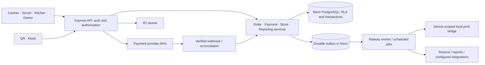

# Architecture and domain contracts

This is the target architecture. Names below are proposed new modules/tables, not claims that implementation already exists.

## Application structure

Use a modular monolith: one Express API, one React/Vite application with role-specific routes, and shared TypeScript domain/validation packages where useful. QR/kiosk can have a separate frontend entry point while sharing the same catalog, checkout contracts, and services. Do not build microservices to reproduce existing screens.

Keep feature code organized around `auth`, `tenancy`, `catalog`, `orders`, `payments`, `kitchen`, `inventory`, `purchasing`, `cash`, `reporting`, `team`, `billing`, and `integrations`. Transport handlers parse/authorize/delegate; business rules live in testable services. Frontend components do not independently define tax, discounts, payment totals, or stock rules.

## Tenant and identity model

An organization owns restaurants/locations. A restaurant is the primary operational isolation boundary. Memberships assign users/employees to one or more restaurants with capabilities. An organization aggregate must enumerate authorized locations; it is not permission to bypass isolation globally.

Use separate account authentication, short-lived employee/PIN sessions, and device credentials. Hash PINs/passwords with a modern password hashing function and rate-limit attempts. Server checks enforce capability, restaurant, account/device status, and session expiry. Browser account sessions should use secure HttpOnly cookies with appropriate CSRF protection; devices use scoped credentials appropriate to their environment. Never store a reusable manager PIN approval in local storage.

As built (access, migration 023; [ACCESS.md](ACCESS.md)): a browser becomes a device either as a shared **terminal**, paired with a single-use 10-minute code (8 Crockford base32 characters, stored only as an HMAC) that an owner or manager creates in Dispositivos, or as a **personal** device through the owner's or an invited member's Google entry. The signed `gm_device` cookie expires 30 days after the last sign-in and stops working at once when the device is unpaired. Staff sign in on a paired device by choosing their name and entering a PIN; PIN failures are throttled per employee and device with staged locks and a hard lock at 100. Every session is created by `createSession()`: `expires_at` slides to at most 8 hours after the last activity and never past `absolute_expires_at` (16 hours after a PIN sign-in). Sessions **end** (logout, switch, PIN reset, role change) or are **revoked** (employee deactivated, device unpaired), and authentication names the reason so the client shows the lock or the pairing screen. On terminals, refunds, paid-outs, self-approved voids and staff/device commands require a PIN entered within the step-up window (`requireRecentAuth`, `ACCESS_STEP_UP_SECONDS`, default 120 s); a manager approves a cashier's void by choosing their name and entering their own PIN. Idle PIN sessions show a lock screen that keeps the workspace mounted.

Every tenant-owned table needs a non-null tenant ID, RLS `USING` and `WITH CHECK`, and tenant-aware references. Use composite foreign keys where necessary to prevent a row belonging to tenant A from referencing tenant B's menu item, order, device, or ingredient. Grant only necessary permissions. Audit tables disallow arbitrary update/delete for normal roles.

Tenant access must run inside an explicit transaction with `set_config('app.tenant_id', tenantId, true)` on the same connection. The tenant ID comes from validated membership or a scoped public/device credential, not an untrusted header. Missing context throws. Privileged provisioning/migration functions require explicit clients and cannot be the default fallback for ordinary queries.

Keep transactions short. Authenticate and resolve necessary context, then open the operation's transaction; do not hold a database connection while waiting for a terminal, network upload, print acknowledgement, or user action. Test pooling behavior, rollback, aborted requests, and subsequent connection reuse.

## Canonical entities

| Domain | Proposed entities / constraints |
| --- | --- |
| Identity | organizations, restaurants, accounts, memberships, employees, devices, sessions, role capabilities |
| Catalog | menu categories/items, modifier groups/options, item-group links, combos/slots, promotions, price/tax versions |
| Service | tables, orders, order lines, line modifiers, order rounds, fulfillment events, station dispatches/acknowledgements |
| Payments | payment attempts, tenders, tender allocations, payment groups, refund attempts/refunds, provider events |
| Inventory | ingredients/stock items, units/conversions, recipe versions/lines/substitutes, prep runs/inputs/outputs, stock movements, reservations, counts, lots/expiry |
| Purchasing/cash | suppliers, purchase orders/receipts, expenses, recurring expense schedules, cash sessions, cash movements, count records |
| Owner insight | report projections/views, targets, scenario assumptions, alerts and resolutions, report runs |
| Supporting | jobs/outbox, print jobs, audit events, source mappings, import batches/rows/reconciliation, integration credentials |

Choose IDs consistently; UUIDs are a good new-domain default, with source IDs preserved separately. Orders/lines/tenders need immutable identities independent of receipt numbers. Daily receipt/order numbering is generated atomically per restaurant/business date, never from an unlocked `MAX + 1`. Do not promise legally gapless numbering without an established requirement.

## Separate state machines

Preparation/fulfillment: `draft → active → ready → completed`, plus explicitly permitted cancellation. Keep per-round/line acknowledgement fields for station progress rather than manufacturing preparation states from payment methods. A source/channel field records POS/kiosk/QR/delivery/offline origin.

Order balance: `unpaid`, `partially_paid`, `paid`, `partially_refunded`, `refunded` is derived from successful tender/refund allocations under a documented rule. Individual payment attempts have `created`, `pending`, `succeeded`, `failed`, `cancelled`, or `unknown`. Unknown is a recovery state, not a failure that permits an automatic second charge.

Transitions enforce actor permissions, versions, and business invariants. A paid or completed order is not silently overwritten when menu prices change. Editing a dispatched line creates an auditable change/delta; editing a settled financial line uses a correction workflow. Additional rounds never redispatch earlier lines unintentionally.

## Core command contracts

Routes may differ, but all channels must call these operations or equivalent shared services:

| Operation | Inputs | Required behavior |
| --- | --- | --- |
| Quote/create order | Tenant context, menu/option IDs, quantities, service data, request ID | Authoritative prices, validation, immutable snapshot, deduplication |
| Edit/send round | Order ID, expected version, item delta, operation ID | Reject stale edit; persist round and station outbox atomically |
| Record cash | Order ID, amount received, tip, operation ID | Lock balance; validate drawer; one tender/stock effect/receipt result |
| Start provider payment | Order/split ID, method/device, operation ID | Persist attempt/key before external request; avoid duplicate pending collection |
| Reconcile provider result | Verified provider reference and event/result | Check amount/currency/account/order; monotonic state; deduplicate side effects |
| Refund | Original tender/line references, amount, disposition, approval | Prevent over-refund; track pending provider result; preserve original history |
| Sync offline cash | Stable client order ID, signed/validated context, cached quote lineage, collected amount | Atomic order-plus-tender or an explicit reconciliation exception |
| Apply stock movement | Cause/reference, item/lot/unit, signed quantity, operation ID | Tenant-aware lock/check; unique causal posting; consistent aggregate |
| Commit import | Approved batch/version, source mapping | Idempotent history import; no operational side effects |

Use schema validation, explicit API error codes, request IDs, and consistent error envelopes. Scope idempotency by tenant and operation; bind the key to a request hash. Reusing a key with a different payload is a conflict. Concurrent identical requests converge to the same result, not two partially created rows.

## Payments and external effects

Local atomicity covers database records and an outbox. It does not cover remote providers. Persist intent/attempt, call the provider outside the DB transaction with the saved idempotency key, then reconcile the result in a new short transaction. If the process dies between any steps, a worker can query the provider and finish safely.

Webhook endpoints verify provider signatures using the required raw payload, record provider event IDs, resolve the configured merchant/tenant, validate amount and currency, and pass results to the same reconciliation service. Public redirects and browser claims never prove payment. Reject or disable unsigned production webhook handling.

Lock the order/split balance while applying successful money movements. Tips, fees, refunds, and paid allocations are separate fields/records. Keep terminal concurrency controls so one device cannot receive conflicting prompts. A payment group settles multiple orders through allocations while preserving their individual kitchen/receipt lineage.

## Money, tax, and reporting definitions

Store payable values in integer minor units with a currency field and safe-range checks. Parse decimal inputs deliberately. Recipe quantities/yields use explicit decimal precision and unit conversions. Calculate tax according to verified configured rules; preserve tax-inclusive/exclusive settings and line snapshots. Do not scatter a fixed tax rate through UI components.

Tax/invoice requirements must be verified with current provider and applicable official documentation before live use. A source README is not compliance evidence.

Metric contracts must define inclusion by date, status, source, and tax basis:

- Gross merchandise sales, discounts, merchandise refunds, taxes, tips, fees, and commissions are distinct.
- Net sales for contribution reporting excludes pass-through taxes/tips under the chosen documented basis.
- COGS uses cost snapshots. Gross contribution subtracts COGS; contribution after fees subtracts processor fees and delivery commissions separately.
- Operating expense reporting excludes inventory purchases already recognized through COGS for that profit view. Cash-flow views can show the purchase payment, but must label the different basis.
- Cash discrepancy is counted closing cash minus expected closing cash. Expected cash includes opening float, cash tender receipts, cash tips held in drawer when applicable, cash refunds, paid-outs, deposits/removals, and documented adjustments. Cash received/change must reconcile to the tender amount. Overages are not shortages.
- Forecast profit equals displayed forecast sales minus displayed forecast costs on the same basis. Partial-week data is excluded or clearly normalized, not silently treated as a complete week.

Each metric has one implementation and drill-down to its source. Materialized summaries are rebuildable projections, never a second authority on whether an order was paid.

## Stock policy

Define deduction timing once per service policy and channel. For prepared portions, reserve at dispatch where appropriate and consume on the configured irreversible service event. For direct raw recipes, apply one recipe-based movement at the defined event. Prep transforms raw inputs into components; a later component sale does not consume the raw inputs again.

Use recipe/version/cost snapshots, explicit conversion factors, and yield loss. Track waste separately from ordinary sale/preparation consumption. For cancellation/refund, record whether stock can be restored; after cooking, a monetary refund does not imply reusable ingredients. Manager overrides and oversell create visible exceptions.

Persist causal idempotency keys at line/round/movement level. Cached availability must reconcile with ledger/reservations; no silent information-losing clamp. Physical counts post differences from a defined cutoff/version and account for concurrent sales. Expiry applies to remaining lots, not the original receipt quantity forever.

## Offline, jobs, and operational recovery

Scope IndexedDB by tenant/device/session and schema version. Drafts, queued cash sales, attempts, and acknowledged server IDs are durable. Recover in-progress entries after reload, use a cross-tab lease, exponential retry, and explicit conflict/dead-letter states. Pending sales survive logout/switch and are accessible only to authorized recovery. An expired offline permission lease prevents new protected activity; it must not erase already recorded sales.

Use a durable outbox with unique job keys, retries/backoff, leases, expiry, and a recovery screen. Workers may deliver at least once, so consumers deduplicate. Printer jobs have queued, claimed, acknowledged/failed/uncertain states. A socket write alone does not prove paper emerged; manual reprints record actor/reason and a duplicate mark. Separate kitchen screen acknowledgement from print status.

For KDS updates, begin with efficient version/cursor polling or a recoverable SSE stream. Ensure reconnect catches missed events; avoid relying on in-memory broadcast across Railway replicas. Notifications must not hold a tenant transaction open indefinitely.

Logs include correlation IDs, operation type, tenant identifier where appropriate, and safe error codes. Redact credentials, card data, PINs, invoice keys, and sensitive customer fields. Monitor provider-unknown attempts, job failures, stale kitchen devices, sync backlog, stock variance, and database saturation.
