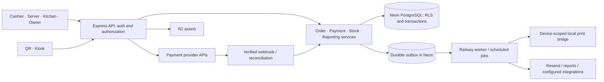

# Architecture and domain contracts

This is the target architecture. Names below are proposed new modules/tables, not claims that implementation already exists.

## Application structure

Use a modular monolith: one Express API, one React/Vite application with role-specific routes, and shared TypeScript domain/validation packages where useful. QR/kiosk can have a separate frontend entry point while sharing the same catalog, checkout contracts, and services. Do not build microservices to reproduce existing screens.

Keep feature code organized around `auth`, `tenancy`, `catalog`, `orders`, `payments`, `kitchen`, `inventory`, `purchasing`, `cash`, `reporting`, `team`, `billing`, and `integrations`. Transport handlers parse/authorize/delegate; business rules live in testable services. Frontend components do not independently define tax, discounts, payment totals, or stock rules.

## Tenant and identity model

An organization owns restaurants/locations. A restaurant is the primary operational isolation boundary. Memberships assign users/employees to one or more restaurants with capabilities. An organization aggregate must enumerate authorized locations; it is not permission to bypass isolation globally.

Use separate account authentication, short-lived employee/PIN sessions, and device credentials. Hash PINs/passwords with a modern password hashing function and rate-limit attempts. Server checks enforce capability, restaurant, account/device status, and session expiry. Browser account sessions should use secure HttpOnly cookies with appropriate CSRF protection; devices use scoped credentials appropriate to their environment. Never store a reusable manager PIN approval in local storage.

As built (access, migration 023; [ACCESS.md](ACCESS.md)): a browser becomes a device either as a shared **terminal**, paired with a single-use 10-minute code (8 Crockford base32 characters, stored only as an HMAC) that an owner or manager creates in Dispositivos, or as a **personal** device through the owner's or an invited member's Google entry. The signed `gm_device` cookie expires 30 days after the last sign-in and stops working at once when the device is unpaired. Staff sign in on a paired device by choosing their name and entering a PIN; PIN failures are throttled per employee and device with staged locks and a hard lock at 100. Every session is created by `createSession()`: `expires_at` slides to at most 8 hours after the last activity and never past `absolute_expires_at` (16 hours after a PIN sign-in). Sessions **end** (logout, switch, PIN reset, role change) or are **revoked** (employee deactivated, device unpaired), and authentication names the reason so the client shows the lock or the pairing screen. On terminals, refunds, paid-outs, self-approved voids and staff/device commands require a PIN entered within the step-up window (`requireRecentAuth`, `ACCESS_STEP_UP_SECONDS`, default 120 s); a manager approves a cashier's void by choosing their name and entering their own PIN. Idle PIN sessions show a lock screen that keeps the workspace mounted.

Every tenant-owned table needs a non-null tenant ID, RLS `USING` and `WITH CHECK`, and tenant-aware references. Use composite foreign keys where necessary to prevent a row belonging to tenant A from referencing tenant B's menu item, order, device, or ingredient. Grant only necessary permissions. Audit tables disallow arbitrary update/delete for normal roles.

Tenant access must run inside an explicit transaction with `set_config('app.tenant_id', tenantId, true)` on the same connection. The tenant ID comes from validated membership or a scoped public/device credential, not an untrusted header. Missing context throws. Privileged provisioning/migration functions require explicit clients and cannot be the default fallback for ordinary queries.

Keep transactions short. Authenticate and resolve necessary context, then open the operation's transaction; do not hold a database connection while waiting for a terminal, network upload, print acknowledgement, or user action. Test pooling behavior, rollback, aborted requests, and subsequent connection reuse.

## Canonical entities

| Domain | Proposed entities / constraints |
| --- | --- |
| Identity | organizations, restaurants, accounts, memberships, employees, devices, sessions, role capabilities |
| Catalog | menu categories/items, modifier groups/options, item-group links, combos/slots, promotions, price/tax versions |
| Service | tables, orders, order lines, line modifiers, order rounds, fulfillment events, station dispatches/acknowledgements |
| Payments | payment attempts, tenders, tender allocations, payment groups, refund attempts/refunds, provider events |
| Inventory | ingredients/stock items, units/conversions, recipe versions/lines/substitutes, prep runs/inputs/outputs, stock movements, reservations, counts, lots/expiry |
| Purchasing/cash | suppliers, purchase orders/receipts, expenses, recurring expense schedules, cash sessions, cash movements, count records |
| Owner insight | report projections/views, targets, scenario assumptions, alerts and resolutions, report runs |
| Supporting | jobs/outbox, print jobs, audit events, source mappings, import batches/rows/reconciliation, integration credentials |

Choose IDs consistently; UUIDs are a good new-domain default, with source IDs preserved separately. Orders/lines/tenders need immutable identities independent of receipt numbers. Daily receipt/order numbering is generated atomically per restaurant/business date, never from an unlocked `MAX + 1`; the daily call number ("#42") keeps resetting each business day and keeps its kitchen role. The fiscal folio is a separate scheme (fiscal 027, [FISCAL.md](FISCAL.md)): tenant-wide per optional series, consecutive and gapless by design because RMF rule 2.7.1.21 requires a consecutive folio on the comprobante simplificado. It comes from a row-locked counter (`fiscal_folio_counters`, not a sequence, so a rollback restores it), a deferred trigger refuses to commit a counter value without its ticket, and `UNIQUE(tenant_id, series, number)` blocks duplicates.

## Separate state machines

Preparation/fulfillment: `draft → active → ready → completed`, plus explicitly permitted cancellation. Keep per-round/line acknowledgement fields for station progress rather than manufacturing preparation states from payment methods. A source/channel field records POS/kiosk/QR/delivery/offline origin.

Order balance: `unpaid`, `partially_paid`, `paid`, `partially_refunded`, `refunded` is derived from successful tender/refund allocations under a documented rule. Individual payment attempts have `created`, `pending`, `succeeded`, `failed`, `cancelled`, or `unknown`. Unknown is a recovery state, not a failure that permits an automatic second charge.

Transitions enforce actor permissions, versions, and business invariants. A paid or completed order is not silently overwritten when menu prices change. Editing a dispatched line creates an auditable change/delta; editing a settled financial line uses a correction workflow. Additional rounds never redispatch earlier lines unintentionally.

## Core command contracts

Routes may differ, but all channels must call these operations or equivalent shared services:

| Operation | Inputs | Required behavior |
| --- | --- | --- |
| Quote/create order | Tenant context, menu/option IDs, quantities, service data, request ID | Authoritative prices, validation, immutable snapshot, deduplication |
| Edit/send round | Order ID, expected version, item delta, operation ID | Reject stale edit; persist round and station outbox atomically |
| Record cash | Order ID, amount received, tip, operation ID | Lock balance; validate drawer; one tender/stock effect/receipt result |
| Start provider payment | Order/split ID, method/device, operation ID | Persist attempt/key before external request; avoid duplicate pending collection |
| Reconcile provider result | Verified provider reference and event/result | Check amount/currency/account/order; monotonic state; deduplicate side effects |
| Refund | Original tender/line references, amount, disposition, approval | Prevent over-refund; track pending provider result; preserve original history |
| Sync offline cash | Stable client order ID, signed/validated context, cached quote lineage, collected amount | Atomic order-plus-tender or an explicit reconciliation exception |
| Apply stock movement | Cause/reference, item/lot/unit, signed quantity, operation ID | Tenant-aware lock/check; unique causal posting; consistent aggregate |
| Commit import | Approved batch/version, source mapping | Idempotent history import; no operational side effects |

Use schema validation, explicit API error codes, request IDs, and consistent error envelopes. Scope idempotency by tenant and operation; bind the key to a request hash. Reusing a key with a different payload is a conflict. Concurrent identical requests converge to the same result, not two partially created rows.

## Payments and external effects

Local atomicity covers database records and an outbox. It does not cover remote providers. Persist intent/attempt, call the provider outside the DB transaction with the saved idempotency key, then reconcile the result in a new short transaction. If the process dies between any steps, a worker can query the provider and finish safely.

Webhook endpoints verify provider signatures using the required raw payload, record provider event IDs, resolve the configured merchant/tenant, validate amount and currency, and pass results to the same reconciliation service. Public redirects and browser claims never prove payment. Reject or disable unsigned production webhook handling.

Lock the order/split balance while applying successful money movements. Tips, fees, refunds, and paid allocations are separate fields/records. Keep terminal concurrency controls so one device cannot receive conflicting prompts. A payment group settles multiple orders through allocations while preserving their individual kitchen/receipt lineage.

Implemented in part ([Payments](PAYMENTS.md), migration 037, phase P1): tender methods are `cash`, `external` (card terminals, manual or integrated) and `platform` ("Pagado por plataforma"); every reader maps them by value and never defaults an unknown value to cash (`methodOf`, the `tests/payments-shared.test.ts` source scan). Named card terminals carry a fee rate whose estimate is stored on the tender (`fee`, `fee_source`); platform tenders carry the platform's estimated commission, cover the whole balance with no tip, stay outside expected cash and card totals, and take the restaurant's CFDI FormaPago for platform tenders (default 31). A platform price list (LD-72) set when an order is rung prices its products. The attempt table, its target-agnostic shape (order or kiosk hold), the transition trigger by actor and the live-attempt guards exist from P1; provider adapters, the worker, webhooks and integrated charging are phase P2.

## Money, tax, and reporting definitions

Store payable values in integer minor units with a currency field and safe-range checks. Parse decimal inputs deliberately. Recipe quantities/yields use explicit decimal precision and unit conversions. Calculate tax according to verified configured rules; preserve tax-inclusive/exclusive settings and line snapshots. Do not scatter a fixed tax rate through UI components. As built (fiscal 027): every menu price includes IVA; `shared/tax.ts` holds the categories, SAT codes and the exact integer extraction, `quote()` stores an immutable per-line snapshot with the server's fiscal context, and `shared/fiscal.ts` builds each ticket's per-category base and IVA, which reconcile to `orders.total` (checked by the database).

Tax/invoice requirements must be verified with current provider and applicable official documentation before live use. A source README is not compliance evidence.

Metric contracts must define inclusion by date, status, source, and tax basis:

- Gross merchandise sales, discounts, merchandise refunds, taxes, tips, fees, and commissions are distinct.
- Net sales for contribution reporting excludes pass-through taxes/tips under the chosen documented basis.
- COGS uses cost snapshots. Gross contribution subtracts COGS; contribution after fees subtracts processor fees and delivery commissions separately.
- Operating expense reporting excludes inventory purchases already recognized through COGS for that profit view. Cash-flow views can show the purchase payment, but must label the different basis.
- Cash discrepancy is counted closing cash minus expected closing cash. Expected cash includes opening float, cash tender receipts, cash tips held in drawer when applicable, cash refunds, paid-outs, deposits/removals, and documented adjustments. Cash received/change must reconcile to the tender amount. Overages are not shortages.
- Forecast profit equals displayed forecast sales minus displayed forecast costs on the same basis. Partial-week data is excluded or clearly normalized, not silently treated as a complete week.

Each metric has one implementation and drill-down to its source. Materialized summaries are rebuildable projections, never a second authority on whether an order was paid.

Implemented ([Reports](REPORTS.md), migration 029): the metric contract in `shared/reports.ts` with IVA taken only from fiscal's `fiscalSummary`; business dates of events use the settings in force at that instant (`business_day_settings`, written by a trigger on `restaurants`, and `business_date_at()`), so a cutoff or timezone change never moves past records; every report and every printed corte reads one `REPEATABLE READ, READ ONLY` snapshot (`server/reports/snapshot.ts`) so its reconciliation checks cannot fail on concurrent writes; a print is then numbered in a separate `READ COMMITTED` transaction under its report-print key. Hoy, Finanzas, the cortes and the remote close read fiscal (027) and discounts (028) through `server/reports/ports.ts`.

## Stock policy

Define deduction timing once per service policy and channel. For prepared portions, reserve at dispatch where appropriate and consume on the configured irreversible service event. For direct raw recipes, apply one recipe-based movement at the defined event. Prep transforms raw inputs into components; a later component sale does not consume the raw inputs again.

Use recipe/version/cost snapshots, explicit conversion factors, and yield loss. Track waste separately from ordinary sale/preparation consumption. For cancellation/refund, record whether stock can be restored; after cooking, a monetary refund does not imply reusable ingredients. Manager overrides and oversell create visible exceptions.

Persist causal idempotency keys at line/round/movement level. Cached availability must reconcile with ledger/reservations; no silent information-losing clamp. Physical counts post differences from a defined cutoff/version and account for concurrent sales. Expiry applies to remaining lots, not the original receipt quantity forever.

Implemented ([Menu, tables and ingredients](MENU.md), migration 025): `stock_movements` is append-only (a trigger refuses UPDATE and DELETE, even for the table owner), and its insert trigger is the only writer of the cached `stock_items.on_hand`, `negative_since` and each movement's `balance_after`, so sales and counts read one locked row instead of summing history. A command locks every stock row it touches at once, in id order (`lockStockItems`), after the order rows and before the drawer ([Global lock order](#global-lock-order-binding), LO-9), and `tenant()` retries a transaction once on a deadlock or serialization failure (a second one is `concurrent_update`), so transaction bodies must be safe to replay. The negative-stock policy is per restaurant: `allow` (default) records the sale and flags the item Negativo; `block` refuses sales, waste and prep inputs past zero with `insufficient_stock`; offline-collected sales and void returns are always recorded.

Implemented ([Discounts, refunds and drawer controls](DISCOUNTS.md), migration 028): money identity for every order with lines, checked at commit once a discount is or was present: `orders.total + orders.discount = Σ order_lines.total − Σ line_voids.amount`, `orders.discount` = the active discount allocations on non-voided units, and `Σ tenders ≤ orders.total`. Discounts and item refunds name payable units like voids and payments (`discount_allocations`, `refund_units`), so a unit's due is gross − discount − paid everywhere (`payableUnits`), voids lower the total by a unit's net and release its discount, and an item refund returns exactly what each tender paid for the unit. Discounts, refund batches, unit and line refunds, reviews and refunds are append-only (triggers, no DELETE grant) and a closed drawer never changes. The kitchen reads `kitchen_removals` (voided units plus refunded units of unserved rounds) for what it must not prepare; totals and order state keep reading `line_voids`, because refunded units are still sold.

## Offline, jobs, and operational recovery

Scope IndexedDB by tenant/device/session and schema version. Drafts, queued cash sales, attempts, and acknowledged server IDs are durable. Recover in-progress entries after reload, use a cross-tab lease, exponential retry, and explicit conflict/dead-letter states. Pending sales survive logout/switch and are accessible only to authorized recovery. An expired offline permission lease prevents new protected activity; it must not erase already recorded sales.

Use a durable outbox with unique job keys, retries/backoff, leases, expiry, and a recovery screen. Workers may deliver at least once, so consumers deduplicate. Printer jobs have queued, claimed, acknowledged/failed/uncertain states. A socket write alone does not prove paper emerged; manual reprints record actor/reason and a duplicate mark. Separate kitchen screen acknowledgement from print status.

Sealed tokens (`server/tokens.ts`, contract C-6) are **signed, not encrypted**: HMAC-SHA256 with a per-purpose HKDF key over `base64url(JSON)`, so whoever holds a sealed link or QR code can read its payload. Payloads carry opaque ids only (tenant, document or order uuids), never secrets, personal data (RFC, name, email, phone), amounts or provider ids such as Facturapi document ids; confidentiality would need a separate AEAD helper, never `seal()`. cfdi's vault `sealSecret` / `sealCsdUpload` are different: they encrypt (JWE).

Implemented ([Service](SERVICE.md), migration 024): every order has a kitchen state (`orders.state`, derived from rounds) and a check state (`check_state` open/paid/closed with `close_reason`); `refreshCheckState` runs after any write that changes total, lines, voids, tenders, mode or table, a closed check's total never changes (trigger), and the KDS polls `kitchen_feed_versions`, which `bumpKitchenFeed` advances at level LO-10 of the [Global lock order](#global-lock-order-binding): after every order, round, void and stock lock of the command, and before the drawer and `refreshCheckState`.

Jobs as built (ops, migration 022; Wave 2.0): two runners share `server/jobs.ts` and `server/jobs/queue.ts`. The **web runner** (`server/index.ts`) claims web kinds registered with `registerJobHandler` in `server/jobs/handlers/<area>.ts`, triggered by authenticated activity plus a 30 s sweep of recently active tenants. The **worker runner** (`server/worker.ts`) runs on its own login (`WORKER_DATABASE_URL`; a deployed worker refuses to start without it, and only a development run goes without the runner) (a member of the `gm_jobs_worker` capability role, checked by `checkWorkerRole`); it claims worker-only kinds registered with `registerWorkerJobHandler` (`server/jobs/worker-registry.ts`) and discovers tenants every 5 s, oldest due first, through the owning area's `SELECT` policy `TO gm_jobs_worker` on `jobs` (cfdi's 030). It runs two lanes (`server/jobs/worker-lanes.ts`), each its own runner with its own global limit and discovery: `payments_*` kinds (8 slots; a cashier waits at the terminal) and every other worker kind (4 slots), so a cfdi backlog of slow Facturapi calls never holds the slots a charge needs. A kind lives in exactly one registry, and the web never imports the worker registry (`tests/import-graph.test.ts`), so the web can never claim a worker kind. Delivery is at least once: handlers are idempotent, and every write is fenced by tenant, job id and lease. `enqueueJob(tx, s, { kind, dedupeKey, payload, state?, runAt? })` writes `next_at = coalesce(runAt, now())`, and the first insert for a `(tenant, kind, dedupeKey)` wins, `runAt` included. Retries are per kind (`maxAttempts` 1–100, default 8): a failure at `attempts >= maxAttempts` goes dead and alerts `jobs_dead_<kind>`, and so does a running job whose lease expired on its last allowed claim (`error_code` `lease_expired`: the process died mid-job), which is never reclaimed. A kind may register an `onDead` hook, which the runner runs inside the transaction of either dead write so the area leaves what the job half did resolvable (payments: a `payments_push` dead with its attempt `sending` makes it `unknown`); the two commit together or not at all (P2-CONCURRENCY-6). A throw rolls the dead write back (`job_dead_hook_failed`): the job stays running and the lease-expiry pass writes both again (on expiry each job is written in its own savepoint, so one failing hook never holds the others or the claim). A staff cancel of such a kind (the web may not run the worker's hooks) marks the job `job_cancel_requested` with its lease expired; no claim takes it, and the runner's expiry pass writes it dead (`cancelled`) with the hook. The worker kinds with a hook are listed in `server/jobs.ts` (`WORKER_DEAD_HOOK_KINDS`, checked at registration) because the web never imports the worker registry. Leases are 10–3600 s at registration and in `ctx.extendLease`. The runner counts the slots a drain has reserved for a claim it is awaiting against the global and per-kind concurrency, so concurrent drains of different tenants never exceed them; a handler that ignores its abort signal past its lease stops counting (`job_lease_expired`), and a drain waiting for a slot gives up after `sweepMs`. Owners and managers retry a dead job or cancel any unfinished one (`POST /api/jobs/:id/requeue`, `/cancel`, with step-up; RUNBOOK "Jobs"). Kinds match `^[a-z][a-z0-9_]{1,63}$` and new kinds carry an `<area>_` prefix (`kitchen_dispatch` and `receipt` predate the rule). Migrations, the runtime grants and retention never run in a Railway process: the GitHub Actions deploy job and the daily retention workflow run them as `gm_migrator` ([RELEASE.md](RELEASE.md)).

Electronic invoicing (cfdi, migration 030; [CFDI](CFDI.md)): the worker jobs runner is the only holder of provider secrets. Facturapi keys and `CREDENTIAL_ENCRYPTION_KEY` live only on the worker, which seals each restaurant's organization keys in `cfdi_secrets` (JWE bound to tenant, purpose and row; unreadable by `gm_app`) and publishes the provider state and a CSD upload public key in `cfdi_platform`. The web process never calls Facturapi: it checks an uploaded CSD locally, seals it to that X25519 key and queues a `cfdi_*` job; nine worker kinds stamp, deliver, cancel, reconcile, build globals and credit notes. cfdi tables are keyed by fiscal tickets (`cfdi_document_tickets` claims `fiscal_tickets`, one active claim per ticket and mode), read fiscal's figures through fiscal's read contract and never recompute IVA. The public portal (`/f/{code}`, `/factura`) resolves a printed self-invoice code through a lookup policy, then works under the code's tenant.

Public QR/kiosk ordering (public, migrations 032, 033 and 034; [PUBLIC_ORDERING](PUBLIC_ORDERING.md)): diners order through revocable codes, never signed links. A code is an opaque 128-bit token stored only as its SHA-256 (`public_links.token_hash`); the page keeps it in the URL fragment (`/qr#<token>`, `/kiosk#<token>`) and sends it in the `x-gm-link-token` header, so no request line, `Referer` or edge log carries it. The pre-auth diner router (`server/public-ordering.ts`, mounted at `/api/public`) runs account's `publicOrderingGate` first, then screens the token's format before any database work, then per-IP ceilings on `clientIp(req)` (menu 60, submit 30, revision 240, status 240, cancel 30 per minute; IPv6 per /56) and per-link budgets, all in memory per replica; it resolves a code through a lookup policy keyed by the hash, then works under the code's tenant. A diner's order is a **hold** (`public_order_holds`): no order number, round, kitchen job, stock movement, feed bump or fiscal ticket until a person accepts it through the unmodified `createOrder` / `addRound` (and `recordPayment` for pay-first). Durable caps per table, link and restaurant are counted under an advisory key inside the submit transaction. Staff routes live under `/api/ordering/*`.

**DB-9 value contract (032/033).** `orders.state`, `orders.channel`, `orders.mode`, `rounds.state` and `jobs.state` carry CHECK constraints (added `NOT VALID` in 032, enforced for every new write at once, validated by 033's no-transaction `VALIDATE` parts). A new value in any of these columns needs a migration that drops and re-adds the constraint (`-- gm:contract-approved`), tests that write it, and a note to public ordering (LD-P13); the value sets are in [PUBLIC_ORDERING](PUBLIC_ORDERING.md) §7.

`getOrders` statement budget (contract C-14): the number of statements is the same for 1 and 10 order ids and at most 10 (service's 7, plus one batched lookup each from offline, fiscal and discounts, in the same `Promise.all`; `tests/service-db.ts`). After discounts' `adjustmentRows` the budget is full: cfdi, account, reports and public ordering add no `getOrders` member.

For KDS updates, begin with efficient version/cursor polling or a recoverable SSE stream. Ensure reconnect catches missed events; avoid relying on in-memory broadcast across Railway replicas. Notifications must not hold a tenant transaction open indefinitely.

Logs include correlation IDs, operation type, tenant identifier where appropriate, and safe error codes. Redact credentials, card data, PINs, invoice keys, and sensitive customer fields. Monitor provider-unknown attempts, job failures, stale kitchen devices, sync backlog, stock variance, and database saturation.

## Global lock order (binding)

Every command that locks rows takes its locks **in this order**, skipping the levels it does not need (critic #9; platform spec §6.2 is the canonical text and `tests/lock-order.test.ts` the static ratchet, whose limits are listed under **Verification** below). Fiscal, discounts, reports, cfdi, account and public ordering keep their own rows below true; a new command names its sequence in these level numbers, adds a row here, and must pass the ratchet without an allowlist entry.

| Level | Object | How it is taken |
| --- | --- | --- |
| LO-0 | Organization and owner-account keys | `pg_advisory_xact_lock(hashtextextended(<organization or account id>, 711 / 918 / 919 / 921))`: billing (711), owner accounts and browsers (918, 919), organizations (921). Taken first, in owner and billing transactions, before any tenant lock. |
| LO-1 | Operation key | `once()`: `pg_advisory_xact_lock(hashtextextended(tenant + operationId, 0))`. Offline archive also takes the archived record's key; financial recovery also takes the key of the record's order operation (LO-R5). |
| LO-2 | `restaurants` row | `FOR SHARE` inside `once()`. `FOR NO KEY UPDATE` by commands that update the row, which `once()` excludes from its `FOR SHARE` (`restaurant.settings`, `stock.policy`; LO-R6). Never `FOR UPDATE`: that would also block the `FOR KEY SHARE` every foreign-key check on `restaurants` takes (PIN throttles, sessions, audit…). |
| LO-2b | `public_order_holds` row | Public ordering (032, LD-8): `lockHold` takes the hold `FOR UPDATE` right after LO-2, as the first row lock of every staff decision and of the diner's cancel; no other area locks a hold row. It judges expiry with `clock_timestamp()` in a second statement and takes no further lock. |
| LO-2c | `payment_attempts` row | Payments (037, critic R4): `FOR UPDATE`, after LO-2b and before LO-3, by the settle, cancel and resolve of a terminal attempt (phase P2) and by the kiosk's hold settle (039). The worker locks an attempt alone, in its own transaction, never during a provider call; the one exception is a dead push's hook (`pushDead`), which locks it right after its own `payments_push` jobs row's dead write, in that transaction (jobs row, then attempt: no transaction locks an attempt and then waits on a `payments_push` jobs row, P2-CONCURRENCY-6). Phase P1 only reads attempts (the live-attempt guards are plain reads under the order, hold or drawer lock). |
| LO-3 | Configuration and area serialization | Rows `menu_state`, `money_controls`, `restaurant_fiscal_profiles`; advisory keys `':floor'`, `':stock-items'`, the offline prefix key, free limits (920; taken before any `devices` or `employees` row lock: PIN sign-in, staff saves and activation, since the platform hardening), pairing codes (923), public ordering's links key (924, then `public_links` rows `FOR UPDATE` in id order) and per-table or per-link submit-cap key (925), the `public_ordering_settings` row, `money.controls` (929), `fiscal.profile` (922), the report-print key (930: reports moved off 926 at its merge, LD-31, because cfdi's per-ticket key uses 926) and cfdi's per-ticket then per-document and per-period keys (926, 927, 928; non-zero classes, so the ratchet reads them as area keys, and `tests/cfdi-locks.test.ts` checks their order). Payments (037): the per-terminal start key (933, `hashtextextended(tenant || ':terminal:' || terminalId, 933)`, phase P2) and the payments configuration key (934, `hashtextextended(tenant || ':payments', 934)`), then the configuration rows `payment_terminals`, `payment_platforms`, `payment_platform_prices`, `payment_device_terminals` and `payment_provider_accounts`; the platform-price save takes 934, then `menu_state` (the revision bump), then its price rows. Advisory classes 920–934 are taken (931/932 account, 933/934 payments); the next free class is 935, reserved for the kiosk (critic R3). Inside one configuration command: the serialization key or `menu_state` → `modifier_groups` → `menu_categories` → `catalog`, or `':floor'` → `dining_areas` → `dining_tables`. Offline `verifyLines` takes `catalog` rows `FOR SHARE`, sorted. |
| LO-4 | `order_numbers`, `public_hold_numbers` | `insert … on conflict do update` per business date (public ordering's hold labels `Q-14`/`K-14`, 032, in `submitHold` only) |
| LO-5 | `orders` rows | `FOR UPDATE`; several rows in **one** statement ordered by id. Then **LO-5a**: `employees FOR SHARE` (approver or assignee checks), right after the order row. |
| LO-6 | Tender keys | `pg_advisory_xact_lock(hashtextextended(tenant + tenderId, 0))`, sorted by tender id (refunds) |
| LO-7 | `rounds` rows | `FOR UPDATE`, with offline `offline_kitchen_reviews` rows taken with their round |
| LO-8 | `line_voids` / `discounts` rows | Inserts, plus `discounts … FOR UPDATE` (reverse) |
| LO-9 | `stock_items` | All at once through `lockStockItems(tx, ids)` (`order by id for update`); `stock()` re-locks one of them (free) |
| LO-10 | `kitchen_feed_versions` (tenant row) | `bumpKitchenFeed(tx, s)` (upsert) |
| LO-11 | `cash_sessions` (the drawer) | `drawer(tx, s)` or `… where id=$ for update`; a new drawer row on open |
| LO-12 | `fiscal_folio_counters` | Only inside fiscal's `issueDueTicket` (reached from `refreshCheckState`, `closeCheck`, `financialRecovery`, `repairMissingTickets`). **Always last.** |

**Rules.**

- **LO-R1.** Within one transaction, levels are non-decreasing. Re-locking an object the transaction already holds is free and is not a step back.
- **LO-R2.** Several rows at one level are locked in one statement ordered by id (orders, stock), or in sorted key order (tender keys); never row by row in input order.
- **LO-R3 (feed).** `bumpKitchenFeed` runs only after every LO-5 to LO-9 lock the command takes, and **before** `refreshCheckState`, `closeCheck`'s issuance and any drawer lock. No command takes the feed after the drawer or the folio counter.
- **LO-R4 (folio).** After LO-12 a command takes no lock below LO-12; inserts (LO-R8) and reads are allowed. Exception E4 below.
- **LO-R5 (nested operation keys).** A `once()` nested in another is allowed only with a freshly generated key (`recordSettlement` → `recordPayment(randomUUID())`, `newTender`), or with the key of the record or sub-operation the command acts on, taken before LO-4: offline sync → `createOrder(order.operationId)`; `financialRecovery` → the order's operation key; `offline.archive` → the archived record's key; `resolvePaymentAttempt` → the attempt's own payment operation key; `reconcileSale` → the draft's order key. Never the key of an unrelated operation.
- **LO-R6 (configuration rows).** Sales paths read configuration without `FOR UPDATE/SHARE`, apart from LO-2 `FOR SHARE` in `once()`, offline's catalog `FOR SHARE` before LO-4, and the two table checks E1 and E2. A command that **updates** `restaurants` takes it `FOR NO KEY UPDATE` at LO-2 and is excluded from `once()`'s `FOR SHARE`. **No SHARE→UPDATE upgrades** (the negative-stock policy save was fixed in Wave 2.0 for this rule).
- **LO-R7 (authentication tables).** `sessions`, `devices`, `pin_throttles` and `employees FOR UPDATE` (PIN counters) are locked only in their own transactions (`verifyApproval`, sign-in, staff commands), never inside a money command; inside money commands employees are read `FOR SHARE` at LO-5a. A sign-in or staff command that can assign a Free slot takes the free-limits key (920, LO-3) **before** those rows: `saveFreeSelection` holds 920 while it updates every slotted device and employee, so the opposite order deadlocked (PLATFORM-LOCKS-6; `tests/free-limits-db.ts` asserts zero retries).
- **LO-R8 (inserts).** Inserts into `jobs`, `audit`, `operations`, `tenders`, `tender_allocations`, `refunds`, `refund_*`, `line_voids`, `fiscal_adjustments`, `fiscal_ticket*` and `cfdi_*`, the cfdi refund and issuance hooks, and payments' `payment_attempt_events` and `drawer_terminal_counts` (037) take no ordering-relevant lock: a unique-key wait can only meet the same logical operation, which LO-1 already serializes. A jobs key shared by unrelated operations would break that premise (a unique-key insert waits on any uncommitted inserter of the key), so every insert under a command's locks carries an id of the operation's own: the cfdi issuance hook (`cfdiTicketsIssued`, LD-55 CFDIFIX-CONCURRENCY-1) keys its tick by the issuing order, which the caller holds FOR UPDATE (LO-5), after a plain read that dedupes against a committed waiting tick. `jobs` rows are locked `FOR UPDATE` only by the runner, in its own transaction. Payments' `payment_attempts` inserts (phase P2's start, the kiosk's hold start) are safe for the same reason: every inserter already holds the terminal key (933) plus the order (LO-5) or the hold (LO-2b), so a wait on the partial unique indexes (`payment_attempts_terminal_live`, `_order_live`, `_hold_live`) can only meet the same logical start, never an unrelated operation; the `payments_settle` jobs key is the attempt's own id.
- **LO-R9 (safety net).** `tenant()` retries 40P01 and 40001 once, then answers 409 `concurrent_update`, and logs `db_retry {code, attempt, retried}` at warn for every one it catches. A 40P01 in any DB suite is a bug, not noise: every concurrent burst in a DB suite that runs through `tenant()` is wrapped in `noRetries()` (`tests/db-retries.ts`), which fails when `tenant()` caught a deadlock or serialization failure during the burst, retried or not, and `tests/db-retries.test.ts` fails when a burst is neither wrapped nor listed with its reason (PLATFORM-LOCKS-3). The listed ones run outside `tenant()` (owner `accountScope`, the billing and Google attempt stores, HTTP fixtures), in transactions that never retry, so a deadlock there fails the test directly; the one deliberate deadlock (`tests/menu-db.ts`) asserts the counter itself.

**Sanctioned exceptions** (no cycle; each is recorded with its reason):

- **E1 (LD-8).** Table orders in `createOrder` take `dining_tables FOR SHARE` (LO-3) after LO-2 and before LO-4. Only floor edits lock tables `FOR UPDATE`, and they lock no orders (they read `orders` without locks through `tablesWithOpenChecks`).
- **E2 (LD-14 OQ-1).** `assignService` takes `dining_tables FOR SHARE` (LO-3) after `orders FOR UPDATE` and `employees FOR SHARE` when a table is given. Same argument as E1; reordering would only change which refusal comes first.
- **E3 (LD-11 MENU-INT-5).** `voidLines` with stock return locks stock rows (LO-9) before each line's round row (LO-7). Rounds are only ever locked under their order's LO-5 lock, which the void already holds. Permanent ratchet entry `voidLines:9>7`.
- **E4 (LD-14 OQ-3, LD-15 fiscal Q4).** Offline sale, order and round sync (`applySale`, `appliers.order`, `appliers.round`) update `rounds` (`placeRoundsInOfflineReview`) after the drawer and, from 027, after the folio counter. Only rows inserted by the same transaction are touched, so no other transaction can hold or wait for them; the reorder is blocked by the foreign key to `offline_sync_records`, whose ledger row needs the tender id first.
- **E5 (sanctioned, lead decision LD-21).** A `refreshCheckState` that cannot issue is not an LO-12 lock: `createOrder`'s (nothing is paid at creation) and `applyRound`'s (a check that takes rounds is not paid, LD-15 fiscal Q2). What follows one in the same transaction is the kitchen feed (`addRound`, whose feed stays after `applyRound` as fiscal's spec §4.4 sets it: moving it earlier would put the feed before stock), or, in offline sale sync (`applySale`), `newTender`'s fresh key, the order row this transaction just inserted and the drawer. The ratchet cannot tell a refresh that may issue from one that cannot, so these pairs are listed.
- **E6 (sanctioned, lead decision LD-21).** Financial recovery after a target lookup: `reconcileSale` (a cancelled online create) and `reconcilers.payment` (an unresolvable target) call `financialRecovery`, whose new order takes an order number (LO-4) after the lookup locked that cancelled order (LO-5) or nothing. No transaction locks `order_numbers` and then an existing order, so no cycle.
- **E7 (LD-15 account Q8; numbered after integration's E5 and E6, LD-21).** `/cash/open` runs account's `autoAssignFreeSlots` after the Free-limits key (LO-3, advisory 920) and before the drawer (LO-11), and it may write `devices.free_slot` and `employees.free_slot`, authentication-table rows that LO-R7 otherwise keeps out of money commands. It writes only when a slot actually changes (an unchanged selection takes no row lock). Since the platform hardening (PLATFORM-LOCKS-6) every command that locks an employee or device row **and** then needs key 920 takes 920 first: the Free selection save, PIN and password sign-in (`signInOnDevice`, the demo login: 920 before the PIN counters), the legacy team save (`saveEmployee`), staff activation and deactivation (`setStaffActive`), invitation acceptance (`employeeSlot`), owner-seat provisioning and promotion (`ensureOwnerSeat`) and support `set-free-device`. The writers that clear a slot without ever taking 920 (device revocation and replacement, owner-seat revocation through `revokeOwnerSeat`/`retirePersonalDevicesAs`) hold only the rows they clear and wait for nothing `/cash/open` holds, and owner seats never hold an employee slot, so no wait cycle exists; a regression would surface as `tenant()`'s single 40P01 retry (`db_retry`, LO-R9) and then `409 concurrent_update`. **Guard (LD-15 Q8, LD-32 OPS-3):** the CI load smoke seeds each restaurant as a Free location on Pro in automatic mode with cashiers allowed to close, and a second register signs three rotating cashiers in by PIN and opens and closes drawers through the whole load phase (every opening evicts the oldest drawer's employee slot); `scripts/load/run-load.ts` fails on any `409 concurrent_update` and reports the server's `db_retry` lines. The ratchet cannot see these writes; `tests/lock-order.test.ts` lists `post /cash/open` as a sanctioned unseen exception and checks the guard is in place.
- **E8 (LD-72, critic R4/Q3; the kiosk's, 039).** The kiosk's fire and hold settle step back over an operation key and the drawer: `kioskAccept:2b>1` (the hold's own order key after the hold, as `acceptHold`'s LD-24 entries), `settleKioskHoldCharge:2c>1` (the hold's order key after the attempt row) and `settleKioskHoldCharge:12>11` (the tender's drawer after the order's issuance inside the nested `createOrder`). Approved by the lead (LD-72); the ratchet's allowlist entries are added by the kiosk track with its code. Payments P1 and P2 take none of them.

**Per-command sequences** (`[12]` means "only when the command settles the check and issues its fiscal ticket" (027); `refresh` is `refreshCheckState`):

| # | Command (file) | Sequence | Status |
| --- | --- | --- | --- |
| 1 | `createOrder` (`server/orders.ts`) | 1 → 2 → 3 (tables, E1) → 4 → 5 (new row) → 9 (`append`) → 7 (new rounds) → jobs insert → 10 → refresh | Conforms since fiscal's merge (LO-R3: the feed before the refresh; it can never issue: nothing is paid). |
| 2 | `addRound`; offline `appliers.round` (`server/offline-tables.ts`) | 1 → 2 → 5 → 9 → 7 (new) → refresh (cannot issue) → 10 / 1 → 2 → 3 (catalog) → 5 → 9 → 7 (new) → refresh → 7 (review, E4), no feed | Conforms with E5 and E4. A check gets its ticket at open→paid and takes no rounds afterwards (LD-15 fiscal Q2). |
| 3 | `recordPayment` | 1 → 2 → 5 → (payments 037: the live-attempt read, the named terminal and the platform row, plain reads) → 11 → refresh [12] (cfdi issuance hook before the counter: a read and at most a jobs insert keyed by this order, LO-R8) | Conforms. |
| 4 | `recordSettlement` (`server/checks.ts`) | 1 → 2 → 5 (all, sorted) → per order: 1′ (fresh key) → 11 → [12] (a later order's cfdi issuance hook runs after an earlier order's counter: a read and at most a jobs insert keyed by that order, LO-R4/LO-R8) | Conforms (LO-R5); cfdi DB "LD-55 CFDIFIX-CONCURRENCY-1" runs it against a concurrent late payment under `noRetries`. |
| 5 | `closeCheck` | 1 → 2 → 5 → 12 (`issueDueTicket`: returns the existing ticket without the counter, or issues a missing one) → `close()` | Conforms. |
| 6 | `voidLines` (`server/voids.ts`) | 1 → 2 → 5 → 5a → 9 (stock return only) → per line 7 → 8 → 9 (re-lock) → 10 → refresh [12] | Conforms since fiscal's merge (the golden tail, LO-R3); `voidLines:9>7` is E3 (permanent). |
| 7 | `acknowledgeVoids` | 1 → 2 → 5 → 7 → 8 (`line_voids` / `refund_lines` acknowledgement updates) → 10 | Conforms. |
| 8 | `assignService` (`server/service.ts`) | 1 → 2 → 5 → 5a → 3 (tables, E2) → 10 → refresh [12] | Conforms since fiscal's merge (LO-R3); `assignService:5a>3` is E2 (permanent). |
| 9 | `progressPreparation` (`server/service.ts`); `recallRound` (`server/kitchen.ts`) | 1 → 2 → 5 → 7 → 10 | Conforms. |
| 10 | `clearStaleRounds` | 1 → 2 → 5 (sorted) → 7 → 8 (`line_voids` / `refund_lines` acknowledgement updates) → 10 | Conforms. |
| 11 | `updateOrderNote` | 1 → 2 → 5 → 10 | Conforms. |
| 12 | Legacy `refund` (`POST /api/refunds`; in `server/refunds.ts` since 028, re-exported by `server/operations.ts`) | 1 → 2 → 5 (the tender's order, LD-15 fiscal Q3) → 6 → 11 → fiscal `recordRefundTax` inserts (through `insertRefundBatch`) | Conforms; see row 26. |
| 13 | `closeCash`, `recordPaidOut`, `/cash/open` | 1 → 2 → 11 (payments 037: `closeDrawerRow` reads the drawer's live attempts and its per-terminal split under the drawer lock, then inserts `drawer_terminal_counts`, LO-R8) / `/cash/open`: 1 → 2 → 3 (free limits 920; `autoAssignFreeSlots` writes device and employee slots only on a change) → 11 | Conforms; the slot writes are exception E7. |
| 14 | Stock adjust, prep, receiving | 1 → 2 → 9 | Conforms. |
| 15 | Offline sale sync (`syncOfflineRecord` → `applySale`; `appliers.order`) | 1 (record) → 2 → 3 (catalog) → `createOrder`: 1′ (order key) → 3 (tables, E1) → 4 → 5 → 9 → 7 → 10 → refresh → `newTender`: 1″ (fresh) → 11 → refresh [12] → ledger insert → 7 (review, E4) | Conforms with E1, E4 and E5 (LO-R5, LO-R6). |
| 16 | Offline payment: `appliers.payment`; `reconcilers.payment` → `reconcileIntoOrder`; `reconcileSale` (`server/offline-tables.ts`, `server/offline-sync.ts`) | 1 → 2 → 5 (`moneyTarget`) → 1′ (fresh, `newTender`) → 11 → refresh [12] → refresh / 1 → 2 → 5 → 11 → refresh [12] / 1 → 2 → 1′ (draft's order key) → 5 → 11 → refresh [12]; a cancelled or unresolvable target goes to `financialRecovery` (E6) | Conforms (LO-R5, E6). |
| 17 | `financialRecovery` (`server/offline-sync.ts`) | 1 → 2 → 1′ (order key, when the record has an order) → 4 → 5 (new) → 11 → 12 (`issueDueTicket(…, "recovery")`) | Conforms. |
| 18 | Offline kitchen decision (`server/offline-kitchen.ts`) | 1 → 2 → 5 → 7 (round + review) → 8 (`line_voids` / `refund_lines` acknowledgement on `already_served`) → 10 | Conforms. |
| 19 | `saveSettings` (`server/restaurant.ts`); `saveOfflineSettings` (`server/offline-settings.ts`) | 1 (`once()` skips `FOR SHARE`) → 2 `FOR NO KEY UPDATE` / 2 `FOR NO KEY UPDATE` without `once()` (deliberate, LD-7) | Conforms. |
| 20 | Menu, floor and stock-item configuration saves | 1 → 2 → 3 (internal order as in LO-3) → (9 for stock items) | Conforms. |
| 21 | `saveNegativeStockPolicy` (`server/stock-items.ts`) | 1 (`once()` skips `FOR SHARE`) → 2 `FOR NO KEY UPDATE` → update | Conforms since Wave 2.0 (it used to upgrade SHARE→UPDATE: D20, P-18; `FOR NO KEY UPDATE` since the platform hardening, PLATFORM-LOCKS-5). |
| 22 | `resolvePaymentAttempt` (`server/offline-attempts.ts`) | 1 → 2 → 1′ (the attempt's payment key) → 5 → 11 → refresh [12] | Conforms (LO-R5). |
| 23 | `resolveOfflineRecoveryTask` (`server/offline-sync.ts`); `recordPrint` (`server/checks.ts`) | 1 → 2 → 5 → task row / no locks | Conforms. |
| 24 | fiscal `saveFiscalProfile` / `repairMissingTickets` (`server/fiscal.ts`) | 1 → 2 → 3 (`fiscal.profile` key 922, then the profile row) / 1 → 2 → 5 (at most 20 candidates, one statement sorted by id; then the missing-ticket predicate again) → reads → cfdi issuance hook for the batch (a read and at most a jobs insert keyed by its first order, LO-R8) → 12 (two statements per ticket, then one insert each for all category and audit rows) | Conforms (fiscal DB "lock order", "CONCURRENCY-1", "SAT-6"). |
| 25 | discounts `applyDiscount` / `reverseDiscount` (`server/discounts.ts`) | (payments 037: `applyDiscount` reads the live attempts right after the order lock, a plain read; loyalty moves it into `recordDiscount`, critic R17) 1 → 2 → 5 → 5a → 8 → [refresh → 12] / 1 → 2 → 5 → 5a → 8 → refresh (raises the balance: never issues) | Conforms (028); no feed, no drawer. |
| 26 | discounts `recordRefund`: items / amount; legacy `refund` (`server/refunds.ts`); platform portions (037) take the same path with no drawer | 1 → 2 → 5 → 5a → 6 → 7 → 9 → 10 (kitchen cancel) → 11 → (9, re-lock for restock) / 1 → 2 → 5 → 5a → 6 → 11 / 1 → 2 → 5 → 6 → 11 | Conforms (028); never calls `refresh`; `recordRefundTax` (fiscal) only inserts. The discounts and fiscal DB tests "lock order …" run it against offline-style sync, settling voids and payments and assert zero `db_retry` (LO-R9). |
| 27 | discounts `saveMoneyControls`; `closeCash`/`closeDrawerRow`/`reviewDrawer` (`server/cash.ts`) | 1 → 2 → 3 (`money.controls` key 929, then the row) / 1 → 2 → 11 / 1 → 2 → 11 (`FOR SHARE`) | Conforms (028). |
| 28 | reports `printDrawerCorte`, `printDayCorte`; remote drawer close (`server/reports/cortes.ts`) | print: the document from a read-only snapshot (no locks), then 1 → 2 → 3 (report-print key, advisory class 930) / close: 1 → 2 → 11 (drawer row `FOR UPDATE`, then discounts' `closeDrawerRow`), the corte Z read after commit | Conforms (029). The report-print key's non-zero class makes it an LO-3 area key, and every report route is its own scanner unit (`server/routes/reports.ts`); the remote close calls `closeDrawerRow` directly, so the scanner follows it. No allowlist entry. |
| 29 | cfdi `POST /cfdi/invoices`, settings, cancel and substitute; `cfdi_global` builder (worker); `cfdi_reissue` cancel-and-replace (worker); `cfdi_cancel` and `cfdi_reissue` credit-note checks, a cancellation's completion (`cfdi_cancel`, `cfdi_reconcile`) and the `cfdi_refund` credit-note decision (worker); the route-III request (a credit note to a global past its CFF 29-A deadline or that credit notes relate to) | 1 → 2 → 3 (per-ticket keys sorted, then document keys) → `cfdi_*` rows / 3 (per-period key) → `cfdi_*` rows / 3 (the global's document key, the same key the invoice request takes, then the period key for the replacement's part) → `cfdi_*` rows / 3 (the cancelled or credited document's key, alone; CFDI-R3-2) → `cfdi_*` rows; the route-III request takes the ticket key, then the global's document key, as the invoice request; the `cfdi_global` builder takes the `cfdi_settings` row `FOR SHARE` before its per-period key, and the tick's month rebuild takes that row `FOR UPDATE` then the month's per-period keys, the order a periodicity save (row `FOR UPDATE`, no key) is consistent with (LD-51 F2; `cfdi_settings` is not an LO table) | Conforms (030, 036); cfdi never locks orders, the drawer or the folio. Every key is an LO-3 area key (classes 926-928); no allowlist entry. |
| 30 | account support CLI unlock and `set-free-device`; owner seat changes (co-owner add/remove/leave, transfer); co-owner invitations and transfers | Own transactions on `employees`, `pin_throttles`, `sessions` and `devices` (LO-R7) / `set-free-device`: 3 (920) → `devices` / organization keys (co-owner limit 931, transfers 932; `acceptTransfer` takes 931 → 932 to re-check the co-owner limit) first, in their own transactions, then each tenant's seat rows; invitation acceptance takes 918 (the accepting account) → 931 before it locks the invitation row, and seat revocation revokes the departing owner's invitations under 931 (ACC-15) | As specified; no money command takes these. No command takes 932 before 931. |
| 31 | PIN or password sign-in (`signInOnDevice`, the demo login); `saveEmployee` (`server/management.ts`); `setStaffActive` (`server/access-staff.ts`) | 3 (free limits, 920) → `devices` / `employees FOR UPDATE` → … → 3 again (free) in `createSession` / `employeeSlot` | Conforms since the platform hardening (LO-R7; they used to lock the employee row first and deadlock against `saveFreeSelection`). |
| 32 | Owner and billing commands (`server/owner-*.ts`, `server/billing-store.ts`) | 0 (organization or account key) → 2 / 3 → … | Conforms (LO-0). |
| 33 | `commitImport` (`server/imports.ts`) | 1 (import key) → 2 `FOR SHARE` → 3 (`menu_state`) → … | Conforms since the platform hardening (it read the restaurant row before taking its key). |
| 34 | public `submitHold` (diner, `server/public-diner.ts`; no `once()`) | 1 (`tenant:public-op:<operationId>`, class 0, disjoint from staff `once()` keys) → 3 (submit-cap key 925 of the table or link) → 3 (`dining_tables FOR SHARE`, table links) → 4 (`public_hold_numbers`) → hold insert | Conforms (032). |
| 35 | public `cancelHold` (diner) | 2b | Conforms (032). |
| 36 | public `acceptHold` (`server/public-holds.ts`): new check / new check with payment / append | 1 → 2 → 2b → 1′ (`h.order_operation_id`, the hold's own key, LO-R5) → [`createOrder` sequence from LO-2] / … as the new check → 1′ (server-fresh key) → [`recordPayment` sequence from LO-2, ending with the ticket at 12] / 1 → 2 → 2b → 1′ (`h.order_operation_id`) → [`addRound` sequence from LO-2]; a ticketed target is refused under its order lock (fiscal D1) | Conforms with LO-R5 and E5. The ratchet sees three pairs no order can avoid, permanent allowlist entries (LD-24): `acceptHold:2b>1` (LO-R5, the hold's own key before LO-4), `acceptHold:12>1` (LO-R5 fresh key after `createOrder`'s refresh, which cannot issue, E5) and `acceptHold:12>11` (E5, then the drawer, as `applySale`). A $0 accept never reaches LO-12. |
| 37 | public `rejectHold` | 1 → 2 → 2b → (abuse deactivation only) 3 (links key 924) → 3 (link row) | Conforms (032). |
| 38 | public `createLink` / `createTableLinks` / `rotateLink` (`server/public-links.ts`; not `once()`: their replies carry tokens) | 3 (links key 924) → 3 (`dining_tables FOR SHARE`, sorted) → 3 (link rows) | Conforms (032). |
| 39 | public `revokeLink` | 1 → 2 → 3 (links key 924) → 3 (link row) | Conforms (032). |
| 40 | public `saveOrderingSettings`, `setPaused` | 1 → 2 → 3 (settings row) | Conforms (032). Rows 34-40 name other commands by name, so fiscal's reorder of `createOrder` never made them false; the dynamic check is public DB 24 (concurrent pay-first accepts, appends, abuse rejections, rotations, drawer closes, settling voids and offline-style sales under `noRetries`). |
| 41 | payments `startCharge` (POS; `startTerminalCharge` wraps it) | 1 → 2 → 3 (933 terminal key) → 5 (order) → 11 (`drawer()`) → attempt and event insert, jobs insert (LO-R8). The kiosk's start (039): 1 → 2 → 2b (hold → checkout) → 3 (933) → [5 when the target is an order] → 11 → insert | Conforms (037 P2): `once()` (1, 2), the 933 key, the order row, `drawer()`, then plain reads (provider, account, Pro, busy terminal) and the inserts; `tests/payments-p2-db.ts` 5 races two starts on one terminal and 15 runs starts in the P2 burst under `noRetries`. |
| 42 | payments `requestCancel` | 1 → 2 → 2c (attempt) → update and event, jobs insert | Conforms (037 P2); `tests/payments-p2-db.ts` 13 (cancel race, Clip refusal). |
| 43 | payments `settleAttempt` (sync route, `payments_settle` job, manager record, operator retry) | 1 (`settle_operation_id`; job and sync race onto the same key) → 2 → 2c → 5 → 11 (the attempt's drawer by id, open or closed) → tender, allocations, audit, attempt update → refresh [12] → receipt job | Conforms (037 P2): the settle key, the restaurant row `FOR SHARE`, the attempt (re-locked free by `applyApprovedAttempt`), the order, the attempt's drawer by id; `operations` is written only with the tender, so a review can be retried. `tests/payments-p2-db.ts` 6 races the job, two syncs and a direct settle (one tender, one ticket, one receipt job) and 15 runs a settle in the burst, all under `noRetries`. |
| 44 | payments `resolveAttempt` (manager: not_charged / refunded_at_provider; anyone: check) | 1 → 2 → 2c → 5 → update, event and audit (check: 1 → 2 → 2c → jobs insert and event). `record` and `retry` run row 43's sequence (their LO-1 is the settle key; no second operation key) | Conforms (037 P2); `tests/payments-p2-db.ts` 7 and the R13 retry check. |
| 45 | payments worker steps (`payments_push/poll/cancel/webhook`) | 2c alone, own transaction per step, never during a provider call; event insert; for `approved` a `payments_settle` jobs insert keyed by the attempt (LO-R8). The account's sealed credential row (`payment_secrets`, worker-only) is updated after 2c when it is re-sealed under a newer kid, and the account row when the provider refuses the credentials; no worker or web transaction locks either before an attempt | Conforms (037 P2); `tests/payments-p2-db.ts` 13 runs every step on the jobs login against the HTTP fake. |
| 46 | payments configuration: `saveTerminal`, `archiveTerminal`, `savePlatforms`, `savePlatformPrices`, `setDeviceTerminal` (`server/payments/settings.ts`; P2 adds `saveCredentials`, `disableProvider`, `requestDevices` and `requestDeviceMode` in `server/payments/providers.ts`; only `requestDeviceMode` uses `once()`: `saveCredentials`' reply carries the one-time notification URL, and the other two are idempotent by state and job key) | 1 → 2 → 3 (934) → [3 `menu_state`, the price save only] → 3 (rows) → audit; the P2 commands without `once()`: 3 (934) → plain reads (live attempts, the platform row) → `payment_secrets` insert and the account row (upsert or update) → jobs insert → audit | Conforms (037 P1 and P2); `tests/payments-db.ts` 15 runs price and terminal saves against payments, voids, rounds and a drawer close under `noRetries`; `tests/payments-p2-db.ts` 14 covers the P2 commands. |

**Verification.** `tests/lock-order.test.ts` runs `tests/lock-scan.ts` over every `server/**/*.ts` (TypeScript compiler API, parse only). For each unit (top-level functions, consts whose initializer holds a function, object-literal and class methods, `X.y = <function>` appliers, and every route registration, also inside ordinary functions) it builds the tree of lock events, expanding calls to other server functions transitively through imports (aliases, re-exports, default exports and namespace imports followed; a builtin lock function imported under another name fails the test), and checks per transaction (`tenant()` and `sql.begin()` start one) that levels never step back unless the object is already held, and that no table locked `FOR SHARE` is later locked for update. Events: `once()` (LO-1, then LO-2 `FOR SHARE` unless its kind is excluded), `bumpKitchenFeed`, `drawer`, `lockStockItems`/`stock`, `refreshCheckState`/`issueDueTicket` (LO-12); `FOR UPDATE`, `FOR NO KEY UPDATE`, `FOR SHARE` and `FOR KEY SHARE` on the tables of this table (public ordering's `public_links` and `public_ordering_settings` at LO-3 and `public_hold_numbers` at LO-4 included since LD-41, PUBLIC-CONCURRENCY-1), `UPDATE` of them (orders excepted), the counter upserts (`public_hold_numbers` and the `public_ordering_settings` row among them), `INSERT INTO stock_movements`, advisory keys by class, in tagged templates and in string arguments to `tx.unsafe`. If/else, switch cases, `?:` and `&&`/`||`/`??` are alternatives, and an early return makes the rest of the block the other alternative. The allowlist is keyed by (unit, level pair), each entry with its reason (E2-E6, LO-R5 including public ordering's three `acceptHold` pairs (LD-24), or an LO-R1 re-lock of restaurants that the caller `syncOfflineRecord` already holds, which a unit alone does not show); all of them are permanent. Fiscal deleted `createOrder:12>10`, `voidLines:12>10` and `assignService:12>10` when it absorbed the scanner, because its feed-before-refresh reorder (LO-R3) makes them pass. An entry that no longer violates fails the test.

**What the ratchet does not prove.** It does not see calls through object properties or callbacks passed around (`appliers[kind](…)`, so `syncOfflineRecord` and its applier are checked separately), SQL built from fragments or variables, which alternative an argument selects, loop repetition or row identity (a second lock of a table counts as a re-lock of the same rows). Nothing static replaces the concurrency suites: every burst that runs through `tenant()` fails on a single retried deadlock (`noRetries`, LO-R9, checked by `tests/db-retries.test.ts`), and fiscal DB "lock order" (`tests/fiscal-db.ts`: offline sync with payment, a settling void, a settling reassignment, single payments and a void with stock return) and discounts DB 22 exercise the indirect sequences. A burst only proves the interleavings it happens to produce.
